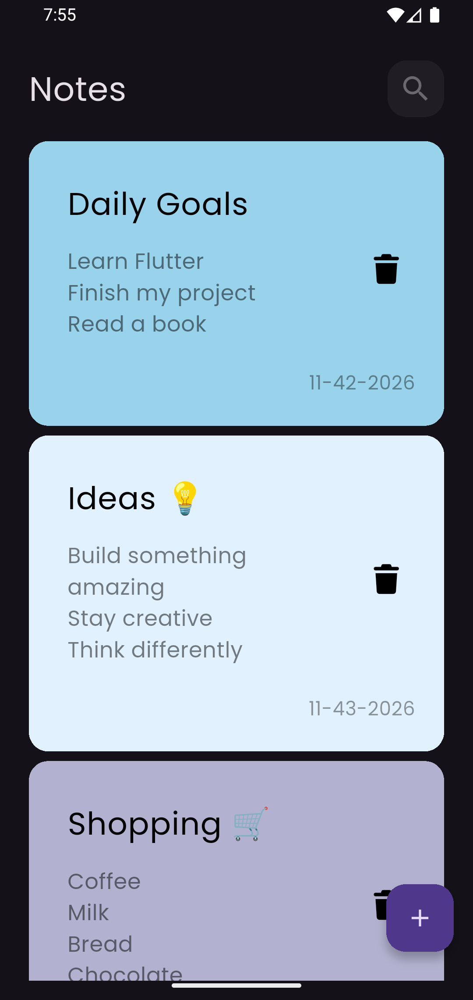
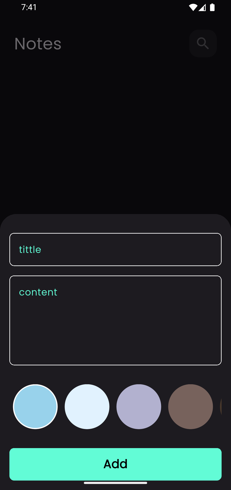
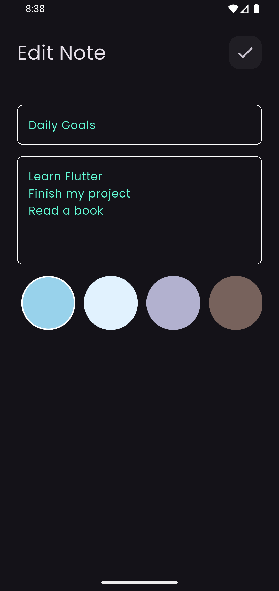
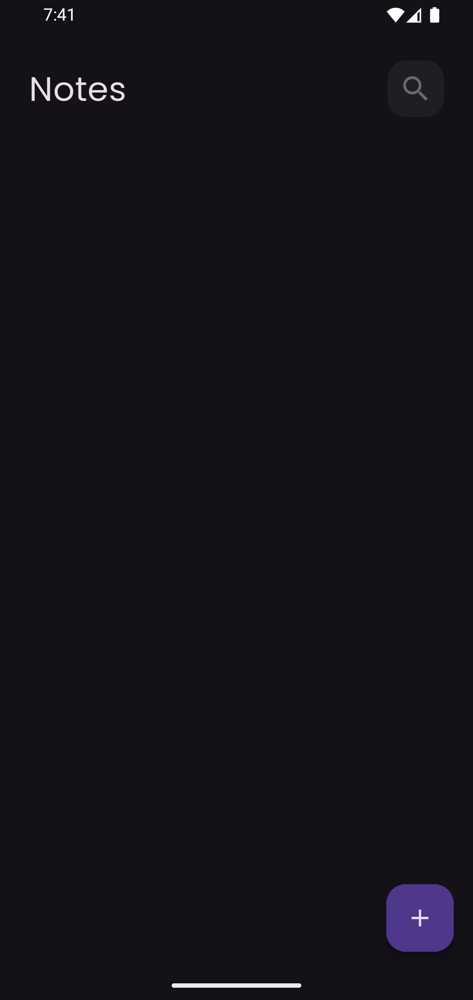
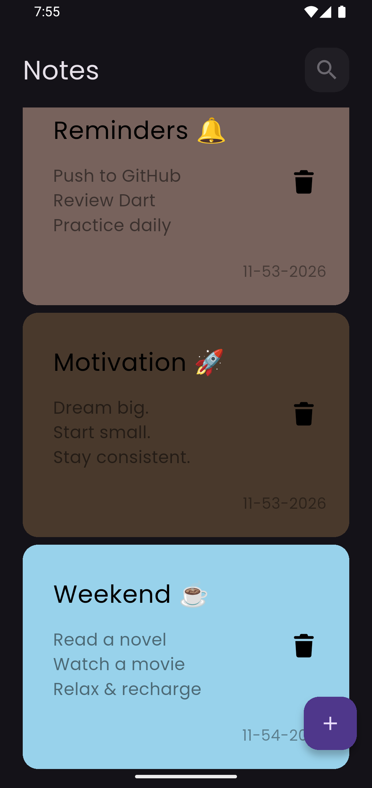
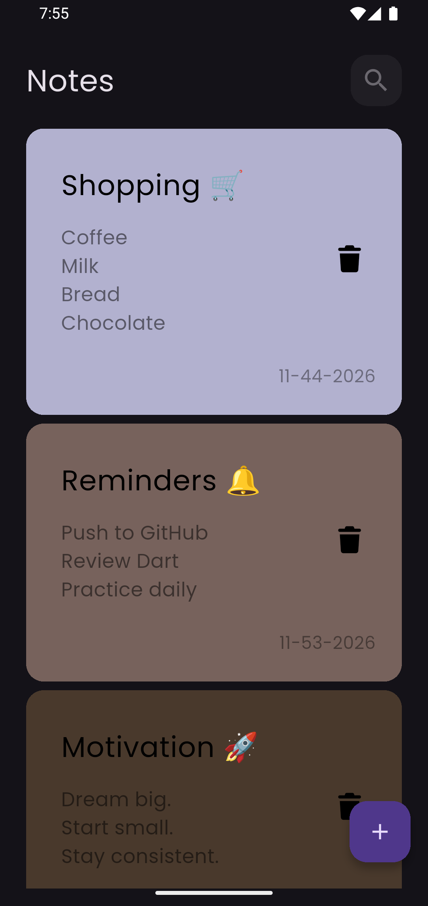
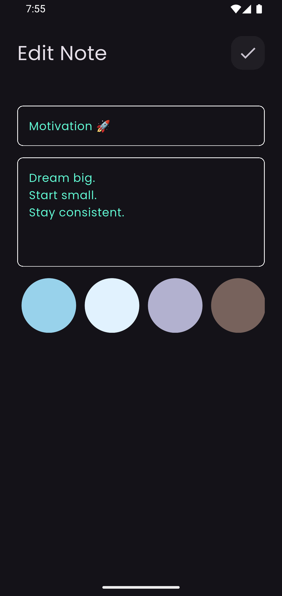
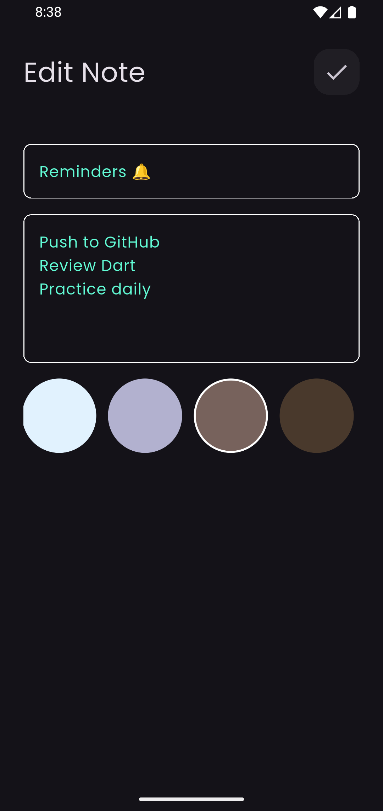

# Notes App

A clean and colorful note-taking app built with **Flutter** and **Dart**. Create notes, edit their content, choose a color for each note, and keep your notes saved locally on your device.

<p align="center">
  
  
  
</p>

## Features

- Create and save notes.
- Edit existing notes.
- Delete notes.
- Choose from multiple note colors.
- Store notes locally with **Hive**.
- Manage app state with **Cubit**.
- Dark interface with custom **Poppins** typography.

## Built With

| Technology | Purpose |
| --- | --- |
| Flutter & Dart | Cross-platform app development |
| flutter_bloc (Cubit) | State management |
| Hive & hive_flutter | Local data storage |
| intl | Date formatting |
| Poppins | Custom typography |

## Screenshots

### Home

<p align="center">
  
  
  
  
</p>

### Add Note

<p align="center">
  
</p>

### Edit Note

<p align="center">
  
  
  
</p>

## Getting Started

### Prerequisites

- Flutter SDK installed.
- An editor such as Android Studio or Visual Studio Code.
- An Android emulator or a connected device.

### Run Locally

1. Clone the repository:

   ```bash
   git clone https://github.com/Aahmedkamell/notes_app.git
   ```

2. Open the project directory:

   ```bash
   cd notes_app
   ```

3. Install dependencies:

   ```bash
   flutter pub get
   ```

4. Run the app:

   ```bash
   flutter run
   ```

## What I Practiced

- Building reusable Flutter UI components.
- Managing state and UI updates with Cubit.
- Persisting custom objects locally with Hive.
- Implementing note creation, editing, and deletion flows.
- Organizing a Flutter project into models, views, and cubits.

## Author

**Ahmed Ashraf**

[GitHub Profile](https://github.com/Aahmedkamell)

---

<p align="center">Built with Flutter ❤️</p>
